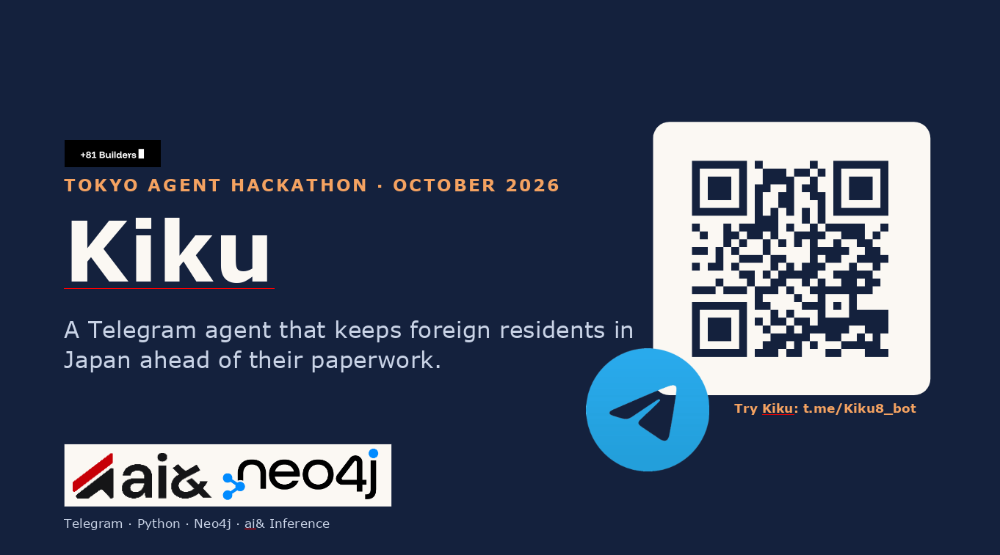

# Kiku (聞く)

A Telegram assistant that helps foreign residents in Japan with government paperwork, one step at a time.

## What it does

- Builds a personal paperwork plan with deadlines and what to bring (move-in/out registration, health insurance, pension, My Number, resident tax, visa extension).
- Answers immigration questions from official Japanese government sites and names the pages it read.
- Reads a residence card PDF or photo on your own computer, and saves only after you tap Save (photo OCR needs macOS).
- Remembers your name, status and goals. It never stores passport, residence card or My Number numbers, and `/forget` deletes everything.

## How it works

Telegram bot (`app/bot.py`) → tool-calling LLM agent (`app/agent.py`) → plan engine and official-site search, with optional Neo4j graph and long-term memory.

## Run

```bash
pip install "python-telegram-bot[job-queue]" python-dotenv openai neo4j httpx cryptography ddgs pypdf
python -m app.bot
```

Create a `.env` file:

```
TELEGRAM_BOT_TOKEN=
AIAND_API_KEY=
AIAND_BASE_URL=
AIAND_MODEL=

# optional
NEO4J_URI=
NEO4J_USERNAME=
NEO4J_PASSWORD=
NAMS_API_KEY=
KIKU_VAULT_KEY=
```

Without Neo4j, progress is kept in memory only.

Commands: `/start` `/plan` `/done` `/memory` `/remind` `/forget`

> Demo only: general guidance, not legal advice.
